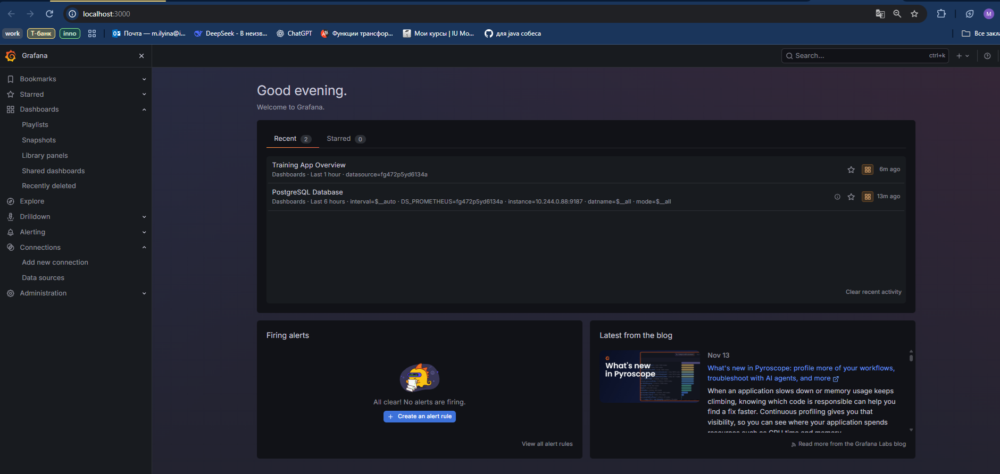
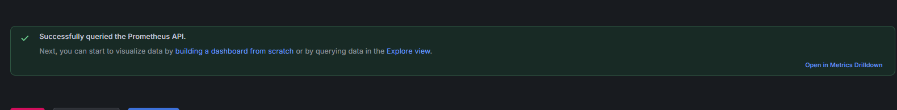
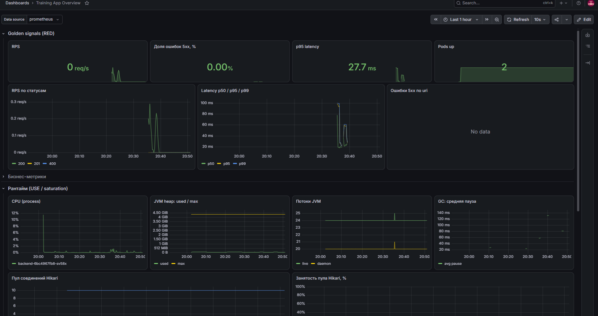
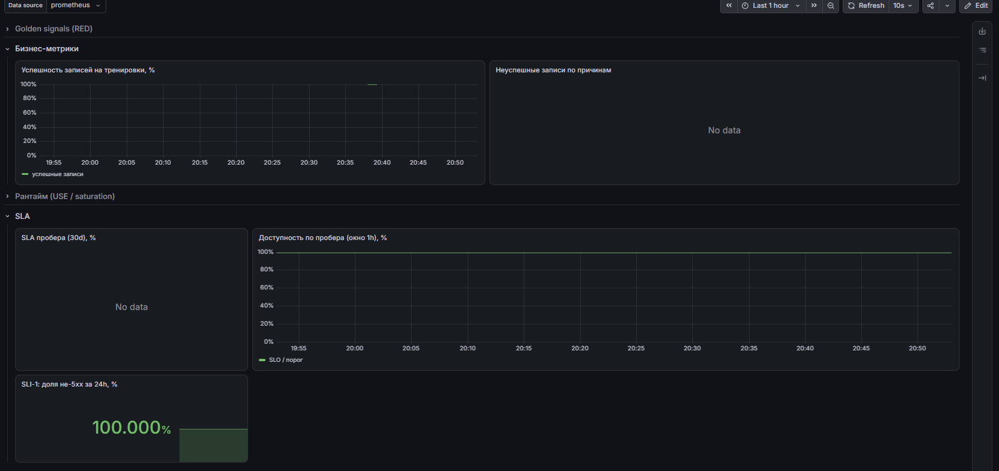
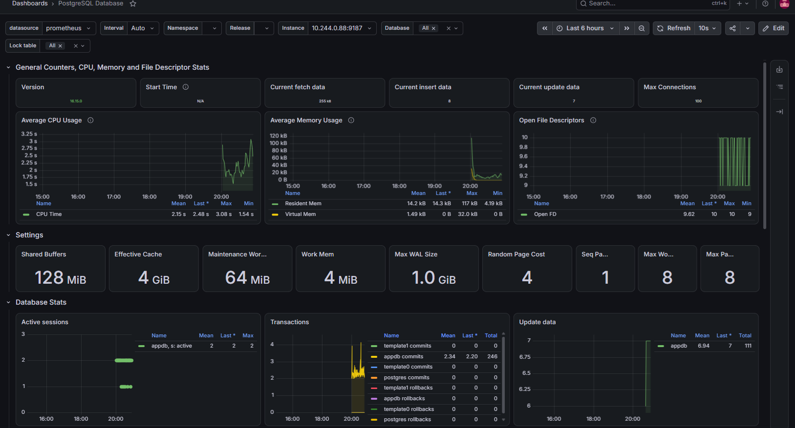
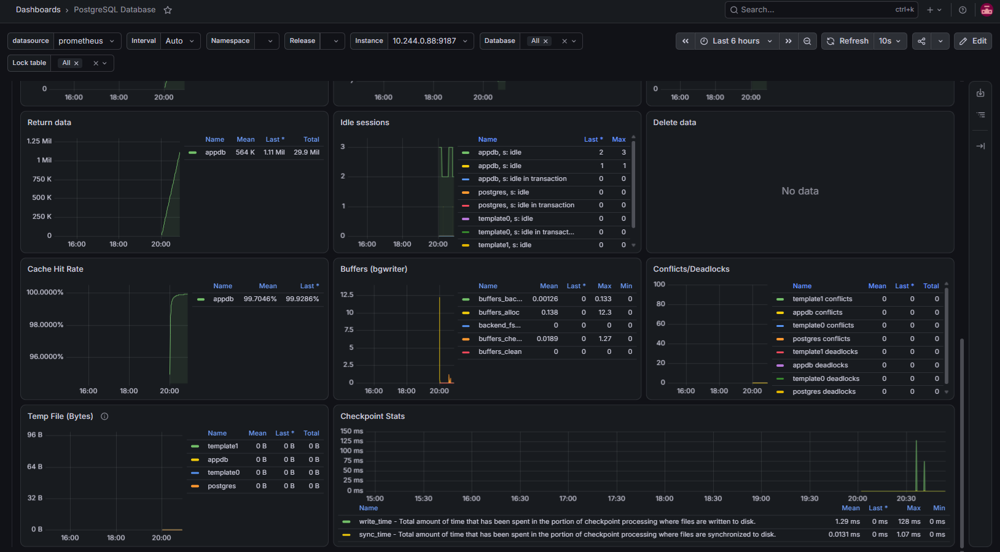

# Отчёт по лабораторной работе: дашборды в Grafana

## 1. Цель работы

На основе метрик из работы по метрикам (экспорт в VictoriaMetrics) и подсчёта SLA из работы по SLI / SLO / SLA построить в Grafana дашборд приложения для записи на тренировки: верхнеуровневые панели состояния, детализацию по рантайму, отдельную панель SLA пробера и импортированный дашборд PostgreSQL Exporter.

## 2. Используемые технологии

- **Grafana** — визуализация метрик, запуск в Minikube через helm-чарт `grafana-community/grafana`.
- **VictoriaMetrics Single + vmui** — хранилище метрик и проверка запросов. Подключена в Grafana как источник типа Prometheus (VictoriaMetrics совместима с его API).
- **Spring Boot Actuator + Micrometer** — метрики сервиса и JVM.
- **Пробер** — два цикла `curl` в командной строке Windows, которые постоянно записывают на тренировки и отменяют записи. Результат фиксируется бизнес-метриками приложения.
- **postgres-exporter** — метрики базы данных PostgreSQL.
- **Kubernetes / Minikube** — окружение запуска.

## 3. Архитектура решения

Все компоненты работают в одном кластере Minikube. Приложение и postgres-exporter отдают метрики, VictoriaMetrics их собирает, Grafana читает данные из VictoriaMetrics по внутреннему адресу сервиса.

`Пробер (curl) → Backend (Actuator) → VictoriaMetrics → Grafana`, а также `postgres-exporter → VictoriaMetrics → Grafana`

## 4. Развёртывание

### 4.1. Grafana

```bash
helm repo add grafana-community https://grafana-community.github.io/helm-charts
helm repo update
helm install grafana grafana-community/grafana -n monitoring --create-namespace
kubectl port-forward svc/grafana 3000:80 -n monitoring
```

Пароль пользователя `admin` сгенерирован чартом и взят из секрета Kubernetes:

```powershell
$p = kubectl get secret grafana -n monitoring -o jsonpath="{.data.admin-password}"
[System.Text.Encoding]::UTF8.GetString([System.Convert]::FromBase64String($p))
```

Grafana доступна по адресу http://localhost:3000.



### 4.2. Data source VictoriaMetrics

Connections → Data sources → Add data source → Prometheus:

- Name: `VictoriaMetrics`
- URL: `http://vm-single-victoria-metrics-single-server:8428`

Grafana работает внутри кластера, поэтому используется адрес сервиса, а не `localhost`. Проверка через Save & test прошла успешно.



## 5. Дашборд приложения

Дашборд импортирован из JSON (Dashboards → New → Import), файл `dashboard.json` приложен к отчёту. Панели сгруппированы по подходам:

- **RED** (Rate, Errors, Duration) — для сервиса: сколько запросов, сколько ошибок, как быстро отвечает.
- **Golden Signals** — к RED добавляется насыщение (saturation) и доступность.
- **USE** (Utilization, Saturation, Errors) — для ресурсов: CPU, память, потоки, пул соединений.

Из запросов исключён служебный трафик (`uri!~"/actuator.*"`), чтобы проверки и сбор метрик не искажали статистику. Для ошибок используется `or vector(0)`, чтобы при отсутствии 5xx панель показывала ноль, а не «нет данных».

### 5.1. Верхний уровень (RED / Golden Signals)



| Панель | Метрика | Зачем |
|---|---|---|
| RPS | `http_server_requests_seconds_count` | Traffic: показывает нагрузку на сервис, по ней видно, с чем коррелируют остальные изменения |
| Доля ошибок 5xx, % | `http_server_requests_seconds_count{status=~"5.."}` | Errors: доля, а не абсолютное число, поэтому не зависит от объёма трафика. Порог 1% соответствует SLA 99% |
| p95 latency | `http_server_requests_seconds_bucket` | Latency: среднее скрывает «хвосты», перцентили показывают, как отвечают самые медленные запросы |
| Pods up | `up{job="kubernetes-pods"}` | Доступность: сколько экземпляров приложения сейчас живы |
| RPS по статусам | `http_server_requests_seconds_count` по `status` | Видно, когда растут 4xx или 5xx и как меняется соотношение статусов |
| Latency p50 / p95 / p99 | `http_server_requests_seconds_bucket` | Сравнение типичной и «хвостовой» задержки на одном графике |
| Ошибки 5xx по uri | `http_server_requests_seconds_count` по `uri` | Локализует проблемный эндпоинт сразу, без поиска по логам |

Для демонстрации включены ошибки 500 для 30% запросов (`/api/debug/errors?percent=30`): на панелях видно рост доли 5xx и появление проблемного `uri`.

### 5.2. Бизнес-метрики



| Панель | Метрика | Зачем |
|---|---|---|
| Успешность записей на тренировки, % | `training_slot_booked_total`, `training_slot_booking_failed_total` | HTTP-метрики могут выглядеть нормально, а пользователи при этом не могут записаться. Панель соответствует SLI-3 |
| Неуспешные записи по причинам | `training_slot_booking_failed_total` по `reason` | Показывает, почему записи не проходят (например, `already_booked`) |

### 5.3. Детализация: рантайм (USE / saturation)


| Панель | Метрика | Зачем |
|---|---|---|
| CPU (process) | `process_cpu_usage` | Utilization процессора |
| JVM heap: used / max | `jvm_memory_used_bytes`, `jvm_memory_max_bytes` (`area="heap"`) | Предвестник `OutOfMemoryError`, показывает запас памяти |
| Потоки JVM | `jvm_threads_live_threads`, `jvm_threads_daemon_threads` | Рост числа потоков указывает на утечки или блокировки |
| GC: средняя пауза | `jvm_gc_pause_seconds_sum / _count` | Долгие паузы сборщика мусора напрямую увеличивают задержку |
| Пул соединений Hikari | `hikaricp_connections_active`, `_pending`, `_max` | Saturation: когда пул исчерпан, запросы ждут соединение с БД |
| Занятость пула Hikari, % | `hikaricp_connections_active / hikaricp_connections_max` | Та же величина, что в алерте `HikariPoolSaturated` (порог 80%) |

## 6. SLA пробера


### 6.1. Пробер

Пробер реализован двумя циклами `curl`, по 500 итераций каждый, которые обращаются к API бэкенда:

```bat
for /l %i in (1,1,500) do @(curl -s -o NUL -X POST "http://localhost:8090/api/training-slots/SLOT_B/book" -H "Content-Type: application/json" -d "{\"userId\":2}" & ping -n 2 127.0.0.1 >NUL)
```

Первый цикл раз в секунду пытается записать пользователя на слот `SLOT_B`. Если слот уже занят, запись завершается неуспешно, и растёт `training_slot_booking_failed_total{reason="already_booked"}`.

```bat
for /l %i in (1,1,500) do @(curl -s -o NUL -X POST "http://localhost:8090/api/training-slots/SLOT_A/book" -H "Content-Type: application/json" -d "{\"userId\":1}" & curl -s -o NUL -X DELETE "http://localhost:8090/api/training-slots/SLOT_A/book?userId=1" & ping -n 3 127.0.0.1 >NUL)
```

Второй цикл записывает пользователя на `SLOT_A` и сразу отменяет запись. Так слот освобождается, и каждая итерация даёт успешную запись (`training_slot_booked_total`).

### 6.2. Расчёт SLA

SLA считается как доля успешных записей на тренировки (SLI-3 из работы по SLI / SLO / SLA):

```text
100 * sum(increase(training_slot_booked_total[30d]))
/ (sum(increase(training_slot_booked_total[30d])) + (sum(increase(training_slot_booking_failed_total[30d])) or vector(0)))
```

На дашборд выведены:

- **Gauge «SLA пробера (30d), %»**: значение за окно с цветовыми порогами. Порог SLA для SLI-3 равен 97%.
- **График «SLA пробера (окно 1h)»**: динамика доли успешных записей, на нём видны провалы, когда первый цикл создаёт неуспешные записи. На графике добавлена линия порога 97%.
- **SLI-1 за 24h**: доля ответов без 5xx по метрикам приложения.

> Окно 30d используется как целевое. Если данных в VictoriaMetrics накоплено меньше, gauge показывает значение за фактически доступный период.

## 7. PostgreSQL Exporter




Exporter установлен через helm-чарт `prometheus-community/prometheus-postgres-exporter` в namespace `monitoring` и подключён к сервису `postgres.default.svc:5432`:

```powershell
helm install pg-exporter prometheus-community/prometheus-postgres-exporter -n monitoring `
  --set config.datasource.host=postgres.default.svc `
  --set config.datasource.user=<user> `
  --set config.datasource.password=<password> `
  --set config.datasource.database=<db> `
  --set config.datasource.sslmode=disable
```

Работа exporter проверена в vmui запросом `pg_up` (значение 1). Дашборд импортирован по ID **9628** (Dashboards → New → Import → источник `VictoriaMetrics`). В самом дашборде источник данных называется Prometheus, так как он написан под Prometheus API. VictoriaMetrics поддерживает этот API, поэтому панели работают без изменений. Он показывает число подключений, TPS, cache hit ratio, размер базы данных и блокировки. Для наполнения графиков на приложение была подана нагрузка.

## 8. Вывод

В Grafana подключена VictoriaMetrics и построен дашборд приложения. Верхний уровень построен по RED и Golden Signals (RPS, доля ошибок, задержки, доступность), детализация по USE (CPU, heap, потоки, GC, пул соединений). Бизнес-панели показывают проблемы, которые не видны по HTTP-метрикам. SLA пробера вынесен в отдельный блок и связан с SLO из предыдущих работ. Импортированный дашборд PostgreSQL Exporter показывает состояние базы данных. Все панели используют доли и перцентили вместо абсолютных значений и исключают служебный трафик, поэтому по ним можно судить о состоянии сервиса независимо от нагрузки.