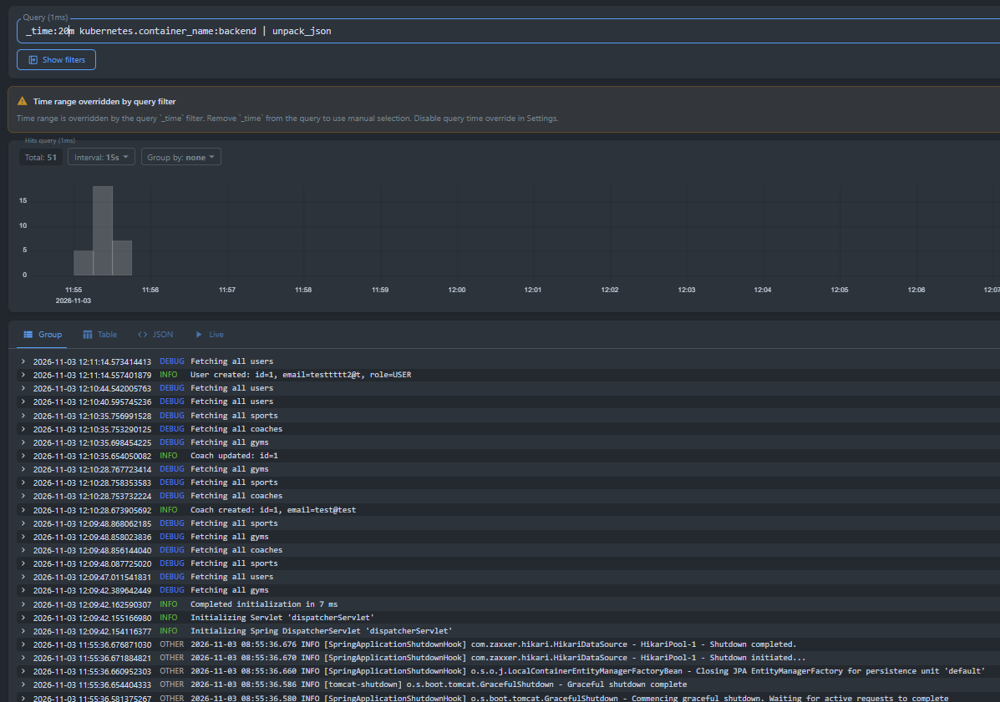
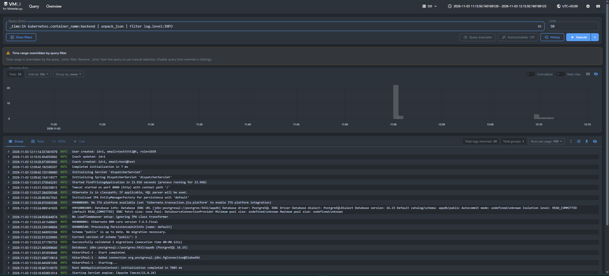
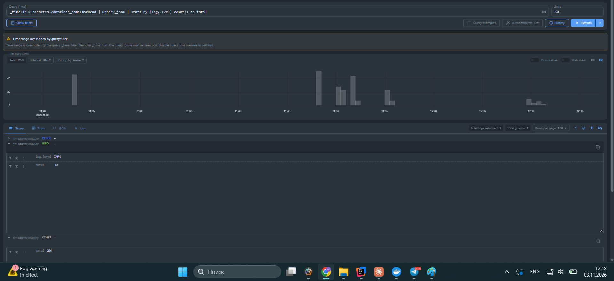
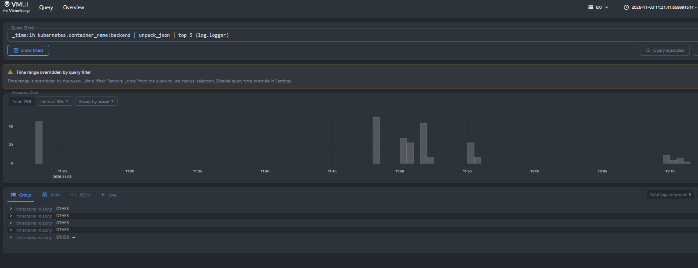

# Отчёт по лабораторной работе: сбор и анализ логов с VictoriaLogs

## 1. Цель работы

Развернуть систему централизованного сбора и анализа логов приложения в Kubernetes с использованием VictoriaLogs. Настроить сбор логов контейнеров, ознакомиться с языком запросов LogsQL и проверить возможность поиска и фильтрации записей.

## 2. Используемые технологии

- **Kubernetes / Minikube** — запуск и управление контейнеризированным приложением.
- **Helm** — установка компонентов системы мониторинга и сбора логов.
- **VictoriaLogs Single** — хранение и поиск логов.
- **VictoriaLogs Collector** — сбор и передача логов.
- **VictoriaLogs UI (VMUI)** — интерфейс для выполнения запросов LogsQL.
- **PostgreSQL** — база данных приложения.

## 3. Архитектура решения

Приложение и система сбора логов развёрнуты в одном кластере Minikube.

Приложение состоит из frontend, backend и PostgreSQL. Компоненты VictoriaLogs размещены в отдельном namespace `logging`.

Предполагаемый поток данных:

`Frontend / Backend / PostgreSQL → Collector → VictoriaLogs → VMUI`

Коллектор предназначен для сбора логов контейнеров и передачи их в VictoriaLogs. Фактический состав поступающих логов проверяется в пользовательском интерфейсе VMUI.

## 4. Развёртывание VictoriaLogs

Для установки был добавлен Helm-репозиторий VictoriaMetrics и обновлён список доступных чартов:

```bash
helm repo add vm https://victoriametrics.github.io/helm-charts/
helm repo update
```

Создан namespace для компонентов логирования:

```bash
kubectl create namespace logging
```

VictoriaLogs Single установлен командой:

```bash
helm install vls vm/victoria-logs-single \
  -n logging \
  --set server.retentionPeriod=7d \
  --set server.persistentVolume.size=2Gi
```

Для проверки состояния компонентов использовалась команда:

```bash
kubectl get pods -n logging
```

В результате проверки под VictoriaLogs Single и под коллектора находились в состоянии `Running`.

## 5. Доступ к интерфейсу

Для доступа к VictoriaLogs UI был выполнен проброс порта:

```bash
kubectl port-forward -n logging \
  svc/vls-victoria-logs-single-server 9428:9428
```

Интерфейс доступен по адресу:

http://localhost:9428/select/vmui/

В VMUI выполнялись запросы LogsQL для просмотра и фильтрации логов.

## 6. Запросы LogsQL

Коллектор записывает JSON-строку приложения в поле `_msg`, а метаданные Kubernetes (`kubernetes.container_name`, `kubernetes.pod_name` и др.) добавляет отдельными полями. Поэтому для работы с полями JSON в запросах используется `unpack_json`, а выборка ограничивается контейнером бэкенда, чтобы не видеть логи остальных подов кластера.

### 6.1. Сырые записи за последние 20 минут

```text
_time:20m kubernetes.container_name:backend | unpack_json
```

Запрос возвращает все записи контейнера бэкенда за последние 20 минут и разбирает JSON из `_msg` на отдельные поля. Он показывает, что логи приложения доходят до VictoriaLogs в формате JSON, а поля `log.level`, `log.logger`, `service.name` и другие доступны для запросов.



### 6.2. Фильтр по конкретному полю

```text
_time:1h kubernetes.container_name:backend | unpack_json | filter log.level:INFO
```

Запрос оставляет только записи с уровнем `INFO`. Он показывает, что поля JSON можно использовать для фильтрации и выбирать из потока логов только нужный уровень.



### 6.3. Статистика с группировкой

```text
_time:1h kubernetes.container_name:backend | unpack_json | stats by (log.level) count() as total
```

Запрос группирует записи по уровню логирования и считает количество в каждой группе. Он показывает соотношение сообщений разных уровней и помогает заметить, если доля предупреждений или ошибок растёт.



### 6.4. Агрегирующий запрос (top)

```text
_time:1h kubernetes.container_name:backend | unpack_json | top 5 (log.logger)
```

Запрос выводит пять классов приложения, которые пишут больше всего логов. Он показывает, какие компоненты формируют основной объём логов, и подсказывает, где искать лишний шум или источник проблем.



## 7. Почему выбран такой способ доставки логов

Логи доставляются коллектором из Helm-чарта VictoriaLogs, который читает файлы логов контейнеров на узле (`/var/log/containers`) и отправляет их в VictoriaLogs. Этот вариант выбран по нескольким причинам:

- код приложения менять не нужно: оно пишет JSON в stdout, как принято в контейнерах, а сбором занимается инфраструктура;
- коллектор работает на узле и собирает логи со всех подов сразу, а при появлении новых сервисов их не нужно настраивать отдельно;
- логи читаются с узла, поэтому не теряются при перезапуске пода приложения;
- к каждой записи автоматически добавляются метаданные Kubernetes (под, контейнер, namespace), по которым удобно фильтровать;
- установка и обновление выполняются одной командой Helm, а конфигурация хранится в `values.yaml`.


## 8. Проверка состояния компонентов

Для проверки состояния компонентов Kubernetes использовалась команда:

```bash
kubectl get pods
```

Для проверки компонентов логирования:

```bash
kubectl get pods -n logging
```

После восстановления окружения VictoriaLogs Single и VictoriaLogs Collector находились в состоянии `Running`. Состояние компонентов приложения проверялось отдельно.

## 9. Вывод

В кластере Minikube развёрнуты VictoriaLogs Single и коллектор. Бэкенд переведён на структурированные JSON-логи, они доходят до VictoriaLogs вместе с метаданными Kubernetes. Выполнены четыре запроса LogsQL: выборка сырых записей, фильтр по полю, группировка со статистикой и агрегация `top`. Результаты подтверждены скриншотами vmui.
